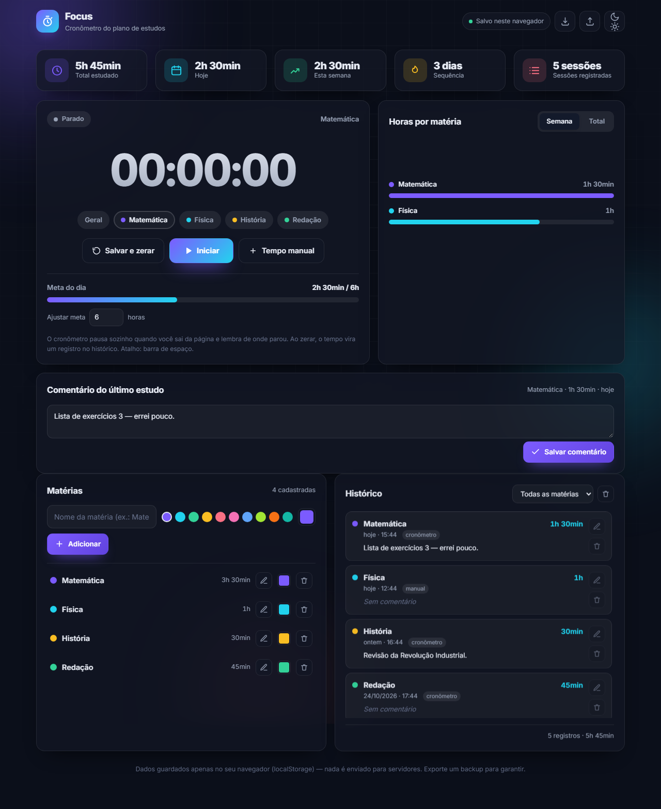

# 🔎 Focus · Cronômetro de Estudos

> Ferramenta **local-first** para acompanhar seus estudos: cronômetro com pausa automática ao fechar a página e relógio visível no título da aba, registro manual de tempo, matérias coloridas, comentários sobre cada estudo, histórico, estatísticas, sequência (streak) e meta diária. Tudo salvo **apenas no seu navegador** — sem servidor, sem conta, sem rastreamento.



## ✨ Funcionalidades

| # | Recurso | Detalhe |
|---|---------|---------|
| 1 | **Cronômetro** | Iniciar / pausar / salvar e zerar. Atalho: **barra de espaço**. |
| 2 | **Pausa automática ao fechar** | Ao fechar ou recarregar a página o cronômetro congela e preserva o tempo; trocar de aba **não** pausa. |
| 3 | **Tempo na aba** | O relógio aparece no título da aba, ao lado do favicon (`01:23:45 · Focus`). |
| 4 | **Registro manual** | Horas + minutos + data + matéria + observação. |
| 5 | **Matérias coloridas** | Cadastro com paleta de cores ou cor personalizada. Editável e excluível. |
| 6 | **Comentários** | Edite um comentário no **último estudo** (destaque) e em qualquer registro do histórico. |
| 7 | **Histórico** | Lista completa, filtro por matéria, origem (cronômetro/manual) e exclusão individual. |
| 8 | **Estatísticas** | Total, hoje, semana, nº de sessões e **sequência de dias**. |
| 9 | **Gráfico por matéria** | Barras por semana ou total, sem bibliotecas externas (SVG nativo). |
| 10 | **Meta diária** | Barra de progresso com meta ajustável (0,5–24 h). |
| 11 | **Backup** | Exportar / importar JSON — seus dados nunca ficam presos. |
| 12 | **Tema claro/escuro** | Persistido entre sessões. |
| 13 | **PWA offline** | Instalável e funcional offline após a primeira visita. |

## 🚀 Início rápido

```bash
npm install
npm run dev        # http://localhost:5173
```

### Scripts disponíveis

| Comando | Descrição |
|---------|-----------|
| `npm run dev` | Servidor de desenvolvimento (HMR) |
| `npm run build` | Type-check + build de produção em `dist/` |
| `npm run preview` | Serve o build de produção localmente |
| `npm run typecheck` | Verificação de tipos (tsc --noEmit) |
| `npm test` | **Testes unitários** (Vitest) |
| `npm run test:e2e` | **Testes E2E** (Playwright, inicia o dev server) |
| `npm run test:all` | Unitários + E2E |

## 🧰 Stack tecnológica

**DECISION:** Vite + TypeScript (vanilla, **zero dependências de runtime**) + PWA + `localStorage` versionado.

| Camada | Tecnologia | Justificativa |
|--------|-----------|---------------|
| Build | **Vite 5** | Dev server instantâneo, build rápido e otimizado |
| Linguagem | **TypeScript 5** (strict) | Segurança de tipos, refatoração segura, testabilidade |
| UI | **Vanilla TS** | Sem framework: superfície de segurança mínima, bundle minúsculo |
| Persistência | **localStorage** + adapter | Local-first, privacidade, sem rede de dados |
| Testes | **Vitest** + **Playwright** | Unitários rápidos + E2E reais no navegador |
| PWA | **Service Worker** nativo | Offline após primeira visita |
| Hospedagem | GitHub Pages / qualquer static host | Custo zero |

> **Bundle:** ~9 KB JS + ~4 KB CSS (gzip), **0 dependências de runtime**.

## 📁 Estrutura

```
├── index.html                # Shell semântico + acessível
├── public/                   # favicon · manifest · service worker
├── src/
│   ├── main.ts               # Entry point + registro do SW
│   ├── domain/               # Lógica pura (sem DOM/storage)
│   │   ├── models.ts         # Tipos + fábricas + constantes
│   │   ├── timer.ts          # Transições do cronômetro (timestamps)
│   │   ├── stats.ts          # Agregações, streak, gráfico
│   │   ├── time.ts           # Formatação e chaves de dia/semana
│   │   └── validation.ts     # Sanitização de toda entrada
│   ├── infra/
│   │   ├── storage.ts        # Adapter versionado + migração + validação
│   │   └── backup.ts         # Export/import JSON seguro
│   ├── ui/
│   │   ├── app.ts            # Raiz de composição (estado + render)
│   │   ├── dom.ts            # Helpers XSS-safe (textContent)
│   │   └── components/       # toast · modal · chart
│   └── styles/main.css       # Design system (temas, responsivo)
├── tests/
│   ├── unit/*.test.ts        # 61 testes unitários
│   └── e2e/app.spec.ts       # 16 testes E2E
└── docs/                     # Arquitetura · Banco · Segurança · Deploy
```

## 🏗️ Arquitetura

Fluxo em três camadas (detalhes em [`docs/ARCHITECTURE.md`](docs/ARCHITECTURE.md)):

```
   UI (src/ui)  ── render puro, tudo via textContent
        │
   DOMAIN (src/domain)  ── lógica pura e testável
        │
   INFRA (src/infra)  ── storage versionado + backup
        │
   Browser: localStorage · Cache API (PWA)
```

## 🔐 Privacidade & Segurança

- **Nada sai do dispositivo.** Sem backend, sem telemetria, sem cookies de terceiros.
- **XSS mitigado:** todo texto do usuário é inserido via `textContent` (nunca `innerHTML`).
- **Entrada validada** na fronteira (`validation.ts`) — inclusive na importação de backup.
- **CSP** restritiva via meta tag.
- Dependências: apenas ferramentas de build/dev, **nenhuma de runtime**.

Detalhes em [`docs/SECURITY.md`](docs/SECURITY.md).

## 📚 Documentação

- [`docs/ARCHITECTURE.md`](docs/ARCHITECTURE.md) — decisões, diagramas, estrutura
- [`docs/DATABASE.md`](docs/DATABASE.md) — esquema do `localStorage`, migração, limites
- [`docs/SECURITY.md`](docs/SECURITY.md) — modelo de ameaças e controles
- [`docs/DEPLOYMENT.md`](docs/DEPLOYMENT.md) — GitHub Pages, Docker, CI/CD
- [`docs/CHANGELOG.md`](docs/CHANGELOG.md) — histórico de versões

> Não há `API.md`: por ser **local-first**, o sistema não expõe HTTP/API — o contrato é o esquema de dados versionado descrito em `DATABASE.md`.

## 🧪 Qualidade

- **61 testes unitários** (domínio, storage, backup, validação) + **16 E2E** (fluxos reais no navegador).
- Type-check estrito (`strict`) no build.
- Acessibilidade: semântica, ARIA, navegação por teclado, `prefers-reduced-motion`.
- **Defeito encontrado na revisão visual e corrigido:** o estado vazio do cartão de comentário não ocultava (atributo `hidden` sobrescrito pelo CSS) — corrigido com regra global `[hidden] { display: none !important }`.

## 📄 Licença

MIT
